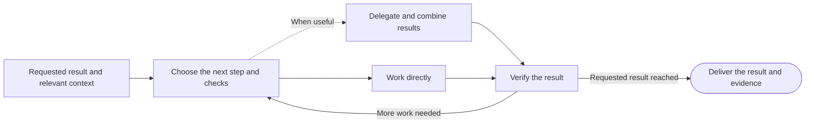

# Contour

Contour gives coding agents a consistent way to investigate a project, make changes and check the result. It follows the project's existing instructions and tools. Extra coordination is used when work spans agents or sessions.

## Get started

Install Contour for your coding agent:

<details>
<summary>Codex CLI</summary>

```bash
codex plugin marketplace add Rckov/contour
codex plugin add contour@contour
```

Start a new session after installation. The plugin is also available to supported Codex desktop clients. For Codex IDE, install the skill separately.

</details>

<details>
<summary>Claude Code</summary>

Run these commands inside Claude Code:

```text
/plugin marketplace add Rckov/contour
/plugin install contour@contour
```

Invoke the skill with `/contour:contour-development`.

</details>

<details>
<summary>Kilo Code or a standalone skill</summary>

Extract the release archive. From its root, copy the complete skill to your user-level skills directory:

```bash
mkdir -p "$HOME/.agents/skills/contour-development"
cp -R skills/contour-development/. "$HOME/.agents/skills/contour-development/"
```

Start a new session. Kilo uses this as an Agent Skill; its native plugin format is different. These instructions cover local clients, not cloud agents.

</details>

The plugins include the Context7 connection. Authenticate it in your client's MCP settings; in Claude Code, use `/mcp`. For a standalone skill, connect it using the [Context7 setup guide](https://context7.com/docs/installation).

Then select Contour and describe the task:

```text
Use Contour.
Task: <what needs to be done>
Constraints: <what must be preserved>
Expected result: <what to deliver>
```

## How it works



## Project files

Contour keeps its working notes, plans, handoffs and check reports in your project's `.contour/` directory. It creates them only when the work needs a durable record; `.contour/work.md` is the usual starting point. Source code, product tests and public documentation use the project's normal layout.

The optional execution tools keep their state in `.contour/runtime/`. Python is needed only when using the optional tools. Local records are ignored by Git by default; deliberately share the records needed to continue in another environment.

## Releases

Commit and push the changes, then push a tag matching the version in both plugin manifests, such as `v1.2.0`. The release workflow attaches `contour-1.2.0.zip` to GitHub Releases. The archive contains the plugin, the standalone skill, and this repository's sources. Re-running the workflow replaces its archive in the same release.

[Methodology](skills/contour-development/references/methodology.md) · [Optional tools](skills/contour-development/references/runtime-workflow.md) · [Sources](skills/contour-development/references/source-provenance.md) · [MIT license](LICENSE)
