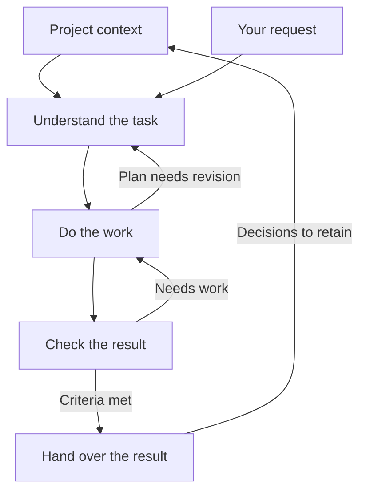

# Contour

Contour is a methodology for AI-assisted software development. It guides coding agents through project work, from understanding the assignment to checking the result. It uses the project's existing instructions and tools, with additional coordination when work spans several agents or sessions.

## Get started

1. Install the complete [contour-development](skills/contour-development) directory through your agent's skill loader, or give it the absolute path to [SKILL.md](skills/contour-development/SKILL.md).
2. Select Contour for the assignment.
3. Describe the task, constraints and expected result:

```text
Use Contour.
Task: <what needs to be done>
Constraints: <what must be preserved>
Expected result: <what to deliver>
```

## Workflow



The agent loads procedures as needed. Delegated work has clear boundaries, and the combined result is checked after integration. On resume, the agent checks current files, prior decisions and unfinished work. Local execution tools are optional, used when their controls are needed or required by project policy.

[Methodology](skills/contour-development/references/methodology.md) · [Optional tools](skills/contour-development/references/runtime-workflow.md) · [Sources](skills/contour-development/references/source-provenance.md) · [MIT license](LICENSE)
