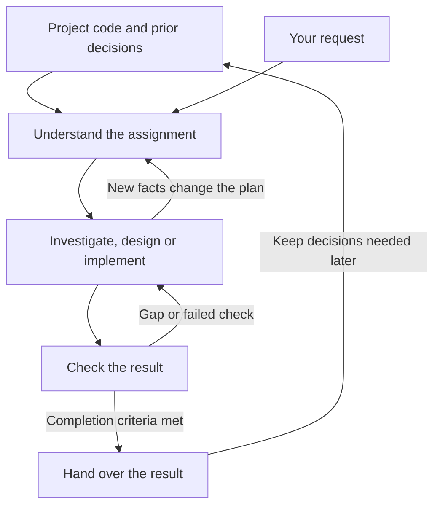

# Contour 1.0

Contour is a methodology for AI-assisted development. It tells a coding agent how to pick up a task in your project, coordinate related work and verify the result.

Start with the work you need done. Contour uses the project's code, instructions and existing commands as its starting point. For a larger project, the same approach carries decisions and unfinished work across sessions, with separate assignments for additional agents when they can help.

## Get started

Keep the complete [contour-development](skills/contour-development) directory together. Install it through your agent's skill loader, or give the agent the absolute path to [SKILL.md](skills/contour-development/SKILL.md). The entry point tells it which procedures to read as the work develops.

Then ask for the result you want. Include any behavior that must stay intact and where the assignment should end:

```text
Use Contour for this task.

Add webhook support to the existing plugin. Keep the current API compatible.
Finish with an implementation and tests ready for review.
```

For repeated use, name Contour and the installed path to `SKILL.md` in your existing project instructions. Keep those instructions as the source of project conventions and permissions.

For work that needs external library or API documentation, make Context7 available to the agent. Contour asks it to check which package and version it actually received, with an official-source fallback when the service is unavailable or the documentation does not match.

## How the work proceeds

The agent establishes the intended result and what would demonstrate that it works. It reads the relevant code and prior decisions, then chooses the next useful action. An investigation may end with an explanation supported by sources. A code change needs checks on the changed behavior.



For work split across agents, each assignment has a defined scope, shared interfaces and a clear return condition. Changes to the same resource are coordinated, and the combined result is checked after integration. On a later session, the agent reconciles the current files and unfinished work before continuing.

`SKILL.md` links to the procedures needed for the work. Local simplification is considered before final verification. [Documentation](skills/contour-development/references/06-api-documentation.md) focuses on what consumers need to use an API or tool, with a bounded Humanizer pass that preserves technical meaning. [Delivery](skills/contour-development/references/07-delivery.md) applies when migration, release or support is part of the assignment.

## Optional local tools

Use your project's existing tools first. The bundled Python commands support bounded code inspection, consistency checks, and a local executor for work that needs persistent ownership, recovery or checks tied to exact file contents.

The local executor requires Linux and Python 3.12. Its core uses the standard library; Git is needed for worktrees and integration. Follow the [setup guide](skills/contour-development/references/runtime-workflow.md) when these controls are needed or required by project policy. The [operation reference](skills/contour-development/references/operations.md) covers the consistency commands.

## Package checks

To use the included [GitHub Actions workflow](.github/workflows/verify.yml), place this directory's contents at the repository root. On a push, pull request or manual run, it builds a ZIP from the commit, extracts it, checks the files against `MANIFEST.json`, and runs basic command checks on Ubuntu. A successful run saves `contour-1.0.zip` as an Actions artifact. Publishing a GitHub Release is a separate step.

These checks cover package integrity and basic command operation. They do not exercise the executor's full workflow.

For the full rules, read the [methodology](skills/contour-development/references/methodology.md). Adapted skills and their sources are recorded in [source provenance](skills/contour-development/references/source-provenance.md).

[MIT license](LICENSE)
