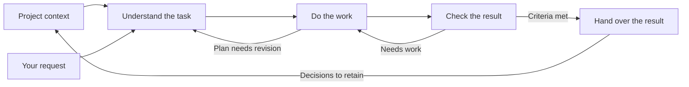

# Contour

Contour gives coding agents a consistent way to investigate a project, make changes and check the result. It follows the project's existing instructions and tools. Extra coordination is used when work spans agents or sessions.

## Get started

1. Install the [contour-development](skills/contour-development) skill or give your agent the absolute path to [SKILL.md](skills/contour-development/SKILL.md).
2. Select Contour for the assignment.
3. Describe the task, constraints and expected result:

```text
Use Contour.
Task: <what needs to be done>
Constraints: <what must be preserved>
Expected result: <what to deliver>
```

## Workflow



The agent loads procedures as needed, gives delegated work clear boundaries and checks the combined result. On resume, it reconciles current files, decisions and unfinished work.

## Project files

Contour keeps its working notes, plans, handoffs and check reports in your project's `.contour/` directory. It creates them only when the work needs a durable record; `.contour/work.md` is the usual starting point. Source code, product tests and public documentation use the project's normal layout.

The optional execution tools keep their state in `.contour/runtime/`. Python is needed only when using the optional tools. Local records are ignored by Git by default; deliberately share the records needed to continue in another environment.

[Methodology](skills/contour-development/references/methodology.md) · [Optional tools](skills/contour-development/references/runtime-workflow.md) · [Sources](skills/contour-development/references/source-provenance.md) · [MIT license](LICENSE)
